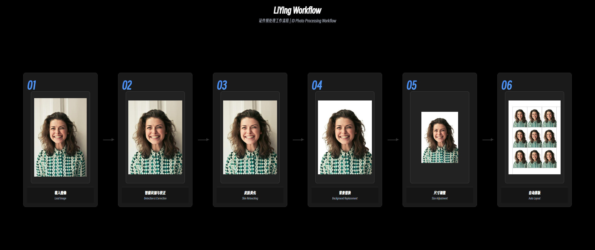
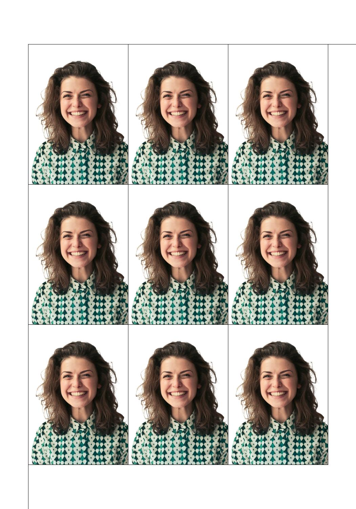
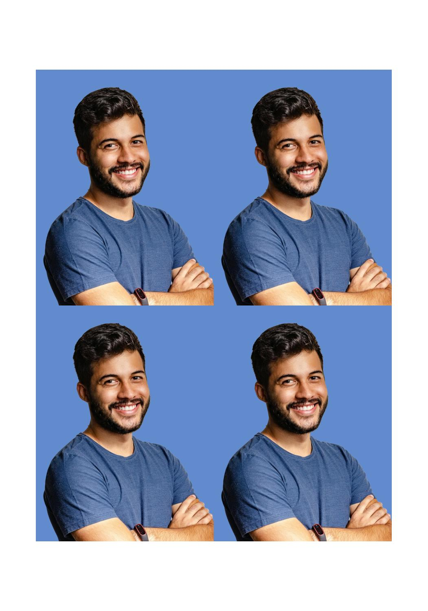
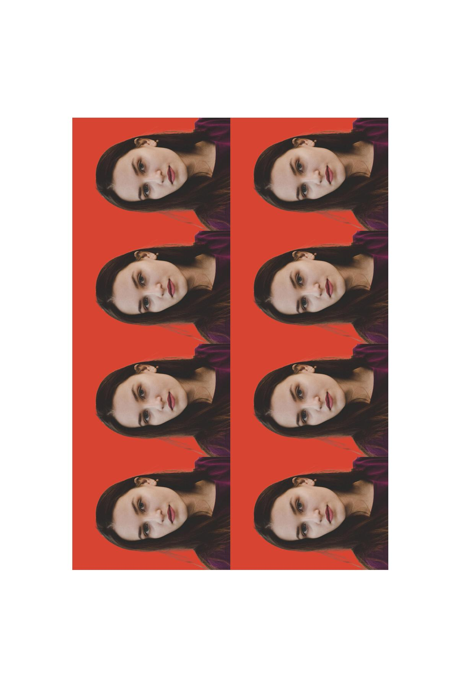
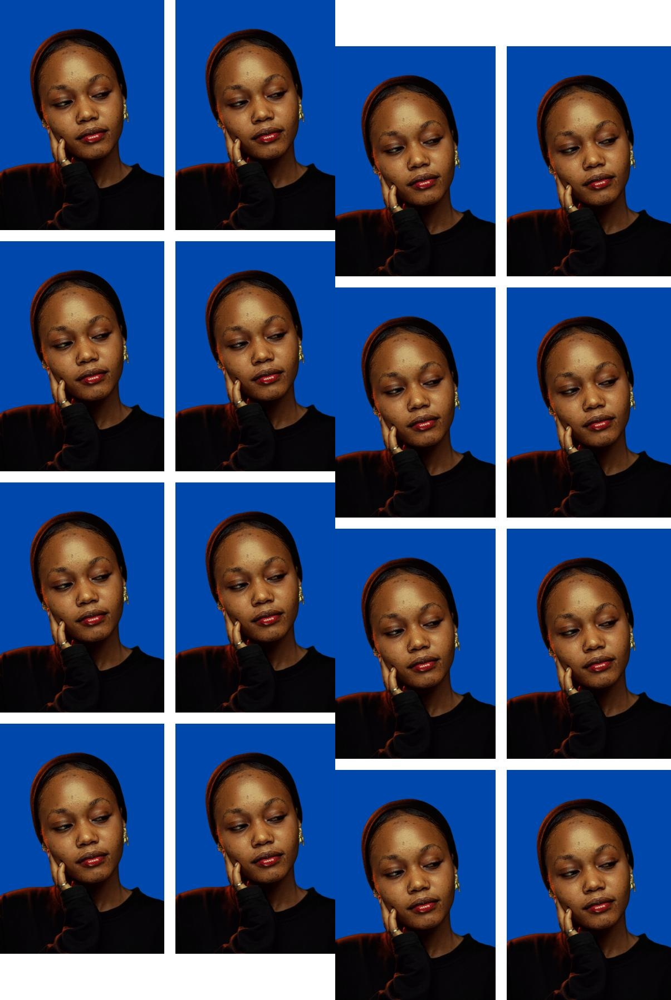
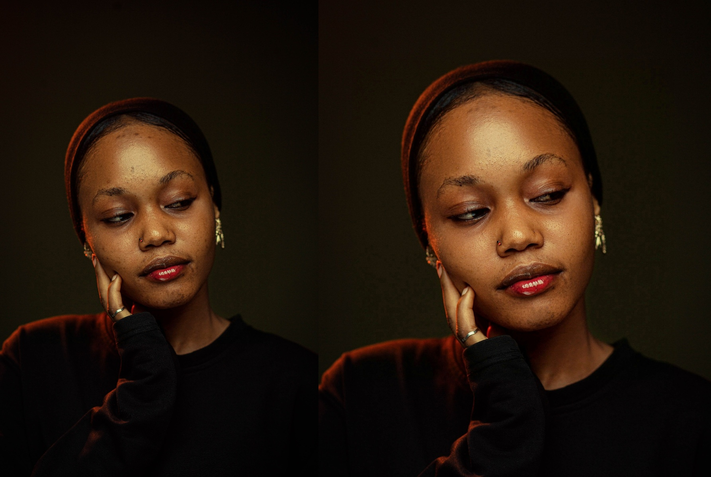

<div align="center">

<h1>LiYing</h1>

[简体中文](./README.md) | [English](./README-EN.md) | 日本語

[](https://github.com/aoguai/LiYing/releases/latest)
[](https://github.com/aoguai/LiYing/stargazers)
[](https://github.com/aoguai/LiYing/issues)
[](https://github.com/aoguai/LiYing/graphs/contributors)
[](https://github.com/aoguai/LiYing/network/members)
[](../LICENSE)

<p>LiYing は、一般的な写真スタジオでの証明写真の後処理の作業を自動化するために作られた、写真の自動処理プログラムです。</p>

</div>

<br>

## 🧭 プロジェクトの紹介

LiYing は、人物の体と顔を自動で認識し、角度を補正し、背景色を変え、証明写真を任意のサイズに切り抜いて、自動で並べることができます。

LiYing は完全にオフラインで動作します。画像の処理はすべてローカルで行われます。

### ワークフロー



### 作例

| 1 インチ · 5 インチの用紙に 3×3 · 白 · 裁断線 | 2 インチ · 5 インチの用紙に 2×2 · 青 | 1 インチ · 6 インチの用紙に 4×2 · 赤 · 写真を 90° 回転 · RMBG-2.0 | 1 インチ · 6 インチの用紙に 4×2 · 濃い青 · 写真の間隔 · 左上と右下の 2 つの配置で用紙を埋める |
| :---: | :---: | :---: | :---: |
|  |  |  |  |

**美肌補正**（`--skin-retouch` のフラグ 1 つで有効になります。左：元の画像、右：デフォルトの強さ — 肌の滑らかさ 0.7 / 美白 0.8）



上の例はすべて、`python docs/scripts/generate_examples.py` のコマンド 1 つで再生成できます。

**注意：このプロジェクトは証明写真の処理専用であり、任意の画像でうまく動作するとは限りません。入力する画像は、標準的な 1 人のポートレート写真にしてください。**

**複雑な画像で証明写真を作ろうとすると、予期しない結果になることがありますが、それは正常です。**

**test4 のサンプル写真は、Bello Danhajiya による [Pexels](https://www.pexels.com/photo/portrait-of-a-woman-with-natural-beauty-35765754/) の写真で、[Pexels License](https://www.pexels.com/license/) のもとで使用しています。**

<br>

## はじめに

### 同梱パッケージ

Windows をお使いで、コードを確認する必要がない場合は、[同梱パッケージをダウンロード](https://github.com/aoguai/LiYing/releases/latest)できます（Windows 7 SP1 と Windows 10 でテスト済み）。

同梱パッケージにはモデルが含まれていません。モデルをダウンロードして正しいディレクトリに置く方法については、[必要なモデルのダウンロード](#-必要なモデルのダウンロード)の節をご覧ください。

プログラムの実行中に問題が起きた場合は、まず[前提条件](#-前提条件)の節を確認して、環境が正しく設定されていることを確かめてください。問題がなければ、この手順は飛ばしてかまいません。

#### 同梱パッケージの実行

BAT スクリプトを実行します。
```shell
cd LiYing
run.bat ./images/test1.jpg
```

WebUI を実行します。
```shell
# Run WebUI
cd LiYing
run_webui.bat
# Open your browser and visit 127.0.0.1:7860
```

### 🛠 前提条件

1. **依存関係**
   - LiYing は AGPicCompress に依存しています
   - AGPicCompress には `mozjpeg` と `pngquant` が必要です
   - `pngquant` は手動でインストールする必要がある場合があります。[pngquant の公式ドキュメント](https://pngquant.org/)を参照してください

2. **pngquant を置く場所**
   - 環境変数（推奨）
   - LiYing/src ディレクトリ
   - LiYing/src の下の `ext` ディレクトリ

3. **システム要件**
   - Windows をお使いの場合は、最新の [Microsoft Visual C++ 再頒布可能パッケージ](https://learn.microsoft.com/en-us/cpp/windows/latest-supported-vc-redist)をインストールする必要があります。
   - Windows をお使いの場合、最低でも Windows 7 SP1 以降が必要です。

### 🧪 ソースからのビルド

1. プロジェクトをクローンします。

```shell
git clone https://github.com/aoguai/LiYing
cd LiYing ## Enter the LiYing directory
pip install -r requirements.txt # Install Python helpers' dependencies
```

**注意：Windows 7 をお使いの場合は、少なくとも Windows 7 SP1 と、`onnxruntime==1.14.0, orjson==3.10.7, gradio==4.44.1` が必要です。**

### GPU による推論の高速化（任意）

NVIDIA の GPU を使って推論を高速化するには、次の手順に従ってください。

1.  [CUDA Toolkit](https://developer.nvidia.com/cuda-downloads) と [cuDNN ライブラリ]((https://developer.nvidia.com/cudnn)) の両方が、システムに正しくインストールされていることを確認します。
2.  [公式の互換性表を参照して、互いに対応する ONNX Runtime、CUDA、cuDNN のバージョンを確認します。](https://onnxruntime.ai/docs/execution-providers/CUDA-ExecutionProvider.html)
3.  GPU に対応した ONNX Runtime のライブラリをインストールします。
    ```bash
    # First, uninstall the CPU-only variant if it is currently installed.
    pip uninstall onnxruntime
    # Install the GPU-enabled version, ensuring its compatibility with your environment.
    pip install onnxruntime-gpu
    ```

現在のバージョンでは、互換性のある GPU があるかどうかを自動で検出するように設計されています。検出されると推論に GPU を優先して使い、GPU がない場合は CPU に自動で切り替えます。この機能に追加の設定は必要ありません。

**何か問題が起きた場合は、まずインストールされている Python、CUDA、cuDNN、`onnxruntime-gpu` のバージョンが互いに対応しているかを必ず確認してください。**

<br>

### 📦 必要なモデルのダウンロード

プロジェクトで使うモデルをダウンロードして `LiYing/src/model` に置くか、コマンドラインでモデルのパスを指定します。

| 用途 | モデル名 | ダウンロードリンク | 出典 |
|---------------------------|-------------------|---------------------------------------------------------------------------------------------------------------------------------------------------------|------------------------------------------------------------|
| 顔認識 | Yunnet / Retinaface（レイアウトには任意、美肌補正には必須） | [Yunnet のダウンロードリンク](https://github.com/opencv/opencv_zoo/blob/main/models/face_detection_yunet/face_detection_yunet_2023mar.onnx) / [Retinaface のプロジェクトのリンク](https://github.com/biubug6/Pytorch_Retinaface) | [Yunnet](https://github.com/ShiqiYu/libfacedetection) / [Pytorch_Retinaface](https://github.com/biubug6/Pytorch_Retinaface) |
| 被写体の認識と背景の置き換え | RMBG-1.4/2.0 | [1.4 のダウンロードリンク](https://huggingface.co/briaai/RMBG-1.4/blob/main/onnx/model.onnx)/[2.0 のダウンロードリンク](https://huggingface.co/briaai/RMBG-2.0/tree/main/onnx) | [BRIA AI](https://huggingface.co/briaai) |
| 体の認識 | yolov8n-pose | [ダウンロードリンク](https://github.com/ultralytics/assets/releases/download/v8.2.0/yolov8n-pose.pt) | [ultralytics](https://github.com/ultralytics/ultralytics) |
| 美肌補正 | cv_unet_skin_retouching_torch / Retinaface | [美肌補正のリンク](https://modelscope.cn/models/damo/cv_unet_skin_retouching_torch/summary) / [Retinaface のプロジェクトのリンク](https://github.com/biubug6/Pytorch_Retinaface) | [ModelScope damo](https://modelscope.cn/organization/damo) / [Pytorch_Retinaface](https://github.com/biubug6/Pytorch_Retinaface) |

**注意：yolov8n-pose のモデルは、ONNX のモデルにエクスポートする必要があります。手順については[公式のドキュメント](https://docs.ultralytics.com/integrations/onnx/)を参照してください。**

**注意：美肌補正の機能では、[skin-retouching-onnxruntime](https://github.com/aoguai/skin-retouching-onnxruntime) に従って自分で ONNX のモデルをエクスポートし、エクスポートした `model.onnx` の名前を `skin_retouch_mask.onnx` に変更することもできます。**

変換済みの ONNX のモデルも用意しているので、ダウンロードしてそのまま使えます。

| ダウンロード方法 | リンク |
|-----------------|--------------------------------------------------------------------------------|
| Google Drive | [ダウンロードリンク](https://drive.google.com/drive/folders/1S36eICyt9rqBtf0TT6-62kjBk-nOfxAu) |
| GitHub Releases | [ダウンロードリンク](https://github.com/aoguai/LiYing/releases/tag/LiYingModel) |
| Baidu Netdisk | [ダウンロードリンク（抽出コード：8gtq）](https://pan.baidu.com/s/1bf-NkuXQCuncYsOlCJvPgw?pwd=8gtq) |

### 🚀 実行

CLI のヘルプを表示します。
```shell
cd LiYing/src
python main.py --help
```

Windows をお使いの方のために、プロジェクトには便利なバッチスクリプトが用意されています。

```shell
# Run BAT script
cd LiYing
run.bat ./images/test1.jpg
```

WebUI を実行します。
```shell
cd LiYing/src/webui
python app.py
```

### 🧾 CLI のパラメーターとヘルプ

```shell
python main.py --help
Usage: main.py [OPTIONS] IMG_PATH

Options:
  -y, --yolov8-model-path PATH    Path to YOLOv8 model
  -u, --yunet-model-path PATH     Path to YuNet model
  --face-detector [yunet|retinaface]
                                  Face detector for the layout pipeline;
                                  retinaface reuses the skin-retouching
                                  face_detector.onnx  [default: yunet]
  -r, --rmbg-model-path PATH      Path to RMBG model
  -sz, --size-config PATH         Path to size configuration file
  -cl, --color-config PATH        Path to color configuration file
  -b, --rgb-list RGB_LIST         RGB(A) channel values list (comma-separated)
                                  for image composition (optional alpha:
                                  0-255)
  -s, --save-path PATH            Path to save the output image
  -p, --photo-type TEXT           Photo types
  -ps, --photo-sheet-size TEXT    Size of the photo sheet
  -c, --compress / --no-compress  Whether to compress the image
  -sv, --save-corrected / --no-save-corrected
                                  Whether to save the corrected image
  -bg, --change-background / --no-change-background
                                  Whether to change the background
  -sb, --save-background / --no-save-background
                                  Whether to save the image with changed
                                  background
  -lo, --layout-only              Only layout the photo without changing
                                  background
  -sr, --sheet-rows INTEGER       Number of rows in the photo sheet
  -sc, --sheet-cols INTEGER       Number of columns in the photo sheet
  -rt, --rotate / --no-rotate     Whether to rotate the photo by 90 degrees
  -rs, --resize / --no-resize     Whether to resize the image
  --ratio-crop / --no-ratio-crop  Crop by photo print-size ratio without
                                  resizing to electronic pixels
  -svr, --save-resized / --no-save-resized
                                  Whether to save the resized image
  -al, --add-crop-lines / --no-add-crop-lines
                                  Add crop lines to the photo sheet
  -ts, --target-size INTEGER      Target file size in KB. When specified,
                                  ignores quality and size-range.
  -szr, --size-range SIZE_RANGE   File size range in KB as min,max (e.g.,
                                  10,20)
  -uc, --use-csv-size / --no-use-csv-size
                                  Whether to use file size limits from CSV
  -lp, --layout-position INTEGER RANGE
                                  Layout position (0-8): 0=top-left, 1=top,
                                  2=top-right, 3=middle-left, 4=center,
                                  5=middle-right, 6=bottom-left, 7=bottom,
                                  8=bottom-right  [0<=x<=8]
  --layout / --no-layout          Whether to generate a photo sheet
  -psp, --photos-spacing INTEGER  Pixel spacing between photos in the sheet
                                  (default: 0)
  --face-height-ratio FLOAT       Face size (0-1, non-zero): larger value
                                  makes the face larger; adjust this first
                                  [default: 0.3]
  --top-margin-ratio FLOAT        Top margin (0-1): larger value moves the
                                  face down; adjust after face size  [default:
                                  0.175]
  --skin-retouch / --no-skin-retouch
                                  Enable automatic skin retouching
  --skin-retouch-model-dir PATH   Directory of skin retouching models
                                  (skin_retouch_mask.onnx,
                                  retouch_generator.onnx, face_detector.onnx)
  --retouch-degree FLOAT RANGE    Skin retouching degree (0-1)  [default: 0.7;
                                  0.0<=x<=1.0]
  --whitening-degree FLOAT RANGE  Skin whitening degree (0-1)  [default: 0.8;
                                  0.0<=x<=1.0]
  --help                          Show this message and exit.
```

顔の高さと頭の上の余白の量を変えることで、ポートレートの構図を個別に調整できます。たとえば、次のパラメーターでは、顔が大きくなり、頭の上の余白が小さくなります。

```shell
python main.py input.jpg --face-height-ratio 0.55 --top-margin-ratio 0.10
```

### 🗂 設定ファイル

このバージョンでは、`data` ディレクトリに標準的な証明写真の設定ファイル（`size_XX.csv`）と、よく使われる色の設定（`color_XX.csv`）が入っています。用意されている CSV のテンプレートの形式に従って、設定を変更、追加、削除できます。

<br>

### 🐳 Docker でのデプロイ

---

#### ️1. イメージのビルド

##### docker-compose でビルドする

プロジェクトのルートディレクトリで、次のコマンドを実行します。

```bash
docker compose build
````

##### 手動でイメージをビルドする

プロジェクトのルートディレクトリで、次のコマンドを実行します。

```bash
docker build -t liying/webui:latest .
```

---

### 2. サービスの起動

次のコマンドで、Gradio の Web UI のサービスを起動します。

```bash
docker compose up -d
```

起動したら、ブラウザーを開いて次の URL にアクセスします。

```
http://127.0.0.1:7860
```

---

問題が起きた場合は、まず `src/model/` に少なくとも 1 つのモデルファイルが置かれていることと、ポートがすでに使われていないことを確認してください。

詳細や高度な設定については、[`Dockerfile`](./Dockerfile) と [`docker-compose.yml`](./docker-compose.yml) をご覧ください。
<br>

## 🙏 謝辞

このプロジェクトは、両親が仕事をもっと楽にこなせるようにと作りました。支えてくれた両親に感謝します。

### 関連プロジェクト

モデルや理論を提供してくださった、次のプロジェクトとコントリビューターに特に感謝します。

- [Yunnet](https://github.com/ShiqiYu/libfacedetection)
- [RMBG-1.4](https://huggingface.co/briaai/RMBG-1.4)
- [ultralytics](https://github.com/ultralytics/ultralytics)
- [cv_unet_skin_retouching_torch](https://modelscope.cn/models/damo/cv_unet_skin_retouching_torch/summary)
- [Pytorch_Retinaface](https://github.com/biubug6/Pytorch_Retinaface)

画像の圧縮の部分にも興味があるかもしれません。こちらは私のもう 1 つのオープンソースプロジェクトです。

- [AGPicCompress](https://github.com/aoguai/AGPicCompress)

これは次のものに依存しています。

- [mozjpeg](https://github.com/mozilla/mozjpeg)
- [pngquant](https://github.com/kornelski/pngquant)
- [mozjpeg-lossless-optimization](https://github.com/wanadev/mozjpeg-lossless-optimization)

<br>

## 🤝 コントリビューション

LiYing はオープンソースのプロジェクトで、コミュニティの参加を大いに歓迎しています。このプロジェクトに貢献するには、[コントリビューションガイド](./CONTRIBUTING.md)に従ってください。

<br>

## 📄 ライセンスについて

[LiYing](https://github.com/aoguai/LiYing) は AGPL-3.0 ライセンスのもとでオープンソースとして公開されています。詳しくは [LICENSE](../LICENSE) ファイルをご覧ください。

<br>

## 💖 スポンサー

このプロジェクトが役に立ったら、どんな形でも感謝の気持ちを示していただけると、とても助かります。ご支援ありがとうございます！

```
USDT(TRON):TWFDp8aZMWZHPXjBodyhfPeK8LUyrWe9mi
```


<br>

## ⭐ Star History

[](https://starhistory.link/aoguai/LiYing)
